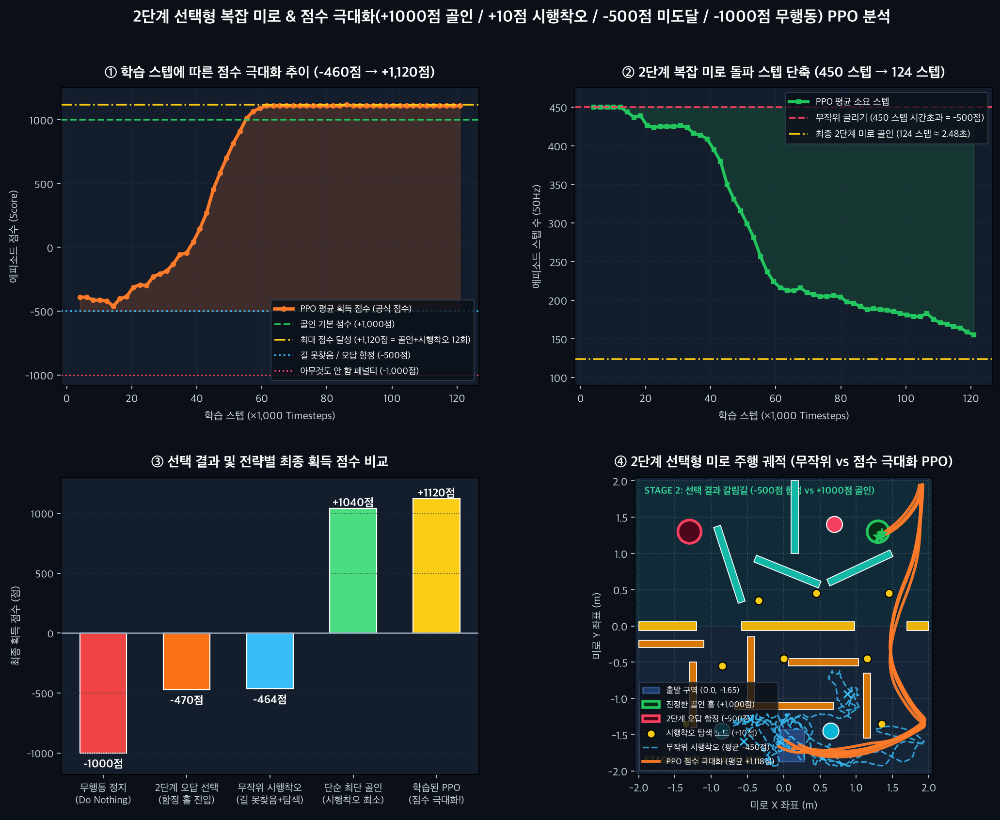

# 🏆 TwoStageBallMaze-v0: Gymnasium MuJoCo 2단계 선택형 복잡 미로 강화학습

Farama [Gymnasium MuJoCo 환경 규격](https://gymnasium.farama.org/environments/mujoco/)(`MujocoEnv`, `EzPickle`)을 준수하여 제작된 **2단계 선택형 복잡 미로(Two-Stage Branching Maze)** 및 **점수 극대화(Score Maximization) PPO 에이전트**입니다.

## 1. 환경 및 미로 설계 (`TwoStageBallMaze-v0`)

- **환경 ID**: `TwoStageBallMaze-v0` (`run:TwoStageBallMazeEnv`)
- **미로 구조 (2단계 선택형 복잡 미로)**:
  1. **1단계 (`Stage 1: y ∈ [-2.0, 0.0]`)**: 하단 출발 구역 `(0.0, -1.65)` 정면 차단벽, 좌측 막다른 함정 포켓(`maze_s1_left_deadend`), 다중 지그재그 격벽으로 구성된 복잡 미로 구간입니다.
  2. **2단계 (`Stage 2: y ∈ [0.0, +2.0]`, 선택에 따라 결과가 바뀜)**:
     - 💀 **오답 함정 루트 (`(-1.30, 1.30)`)**: 잘못된 분기 선택 시 빠지는 좌측 상단 함정 홀로, 길을 찾지 못한 것으로 판정되어 **`-500점`** 페널티와 함께 에피소드가 종료됩니다.
     - 🏆 **진정한 골인 루트 (`(1.30, 1.30)`)**: 수비 격벽과 탄성 범퍼를 우회하여 우측 상단 골인 홀컵에 들어가면 **`+1,000점`**을 획득합니다.

## 2. 보상 체계 및 목표

| 이벤트 / 조건 | 점수 (보상) | 설명 |
| :--- | :---: | :--- |
| **골인지점 도달 시** | **`+1,000점`** | 2단계 우측 상단 진정한 골인 홀 `(1.30, 1.30)` 진입 |
| **시행착오 시** | **`+10점` / 회** | 미로 내 분기 탐색 체크포인트(`trial_node_1~8`) 및 신규 구역 개척 (최대 12회 = `+120점`) |
| **아무것도 하지 않을 시** | **`-1,000점`** | 일정 시간 동안 움직이지 않고 정지 시 즉시 페널티 종료 |
| **길을 못 찾을 시** | **`-500점`** | 2단계 오답 함정 홀 진입 또는 제한 스텝(`450 steps`) 초과 |
| **최종 목표** | **점수의 극대화** | 시행착오 보너스(`+120점`) + 골인(`+1,000점`) 결합 → **최고 `+1,120점` 달성** |

## 3. 학습 데이터 대시보드 및 주행 궤적 비교



## 4. 사용 방법 (Gymnasium & Stable-Baselines3)

```python
import gymnasium as gym
from stable_baselines3 import PPO
import run  # TwoStageBallMaze-v0 자동 등록

gym.register_envs(run)
env = gym.make("TwoStageBallMaze-v0", render_mode="rgb_array", curriculum=False)
model = PPO.load("ppo_two_stage_maze")

obs, info = env.reset(seed=42)
done = False
while not done:
    action, _ = model.predict(obs, deterministic=True)
    obs, reward, terminated, truncated, info = env.step(action)
    done = terminated or truncated

print("Final Official Score:", info["episode_score"], "Outcome:", info["outcome"])
```

### 3D MuJoCo 실시간 비교 뷰어 실행

```bash
python run.py
```
